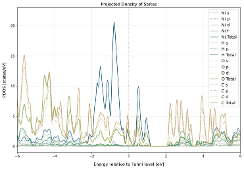

# cp2k-pdos-toolkit

A small, tested Python tool to post-process and plot **Projected Density of
States (PDOS)** output from [CP2K](https://www.cp2k.org/): it applies
Gaussian broadening to CP2K's per-MO eigenvalue/orbital-weight data,
optionally aligns the energy axis to the Fermi level or the Valence Band
Maximum, and writes both a text table and a plot.

This repository consolidates and fixes two earlier prototype scripts. See
[`CHANGELOG.md`](CHANGELOG.md) for the itemized list of what changed and
[`docs/theory.md`](docs/theory.md) for the physics/math behind the main fix.

## Quick start

```bash
git clone https://github.com/diego-garcialopez/cp2k-pdos-toolkit.git
cd cp2k-pdos-toolkit
pip install -e .

python -m pdos_toolkit.pdos_processor \
    pdos_system-k1-1.pdos pdos_system-k2-1.pdos \
    -s 0.05 -d 0.01 --reference fermi --total-dos \
    --plot --plot-output pdos.png -o pdos.dat
```

See [`examples/example_usage.md`](examples/example_usage.md) for more
scenarios (multi-element systems, VBM referencing, library usage).

## Repository layout

```
cp2k-pdos-toolkit/
├── README.md                     <- you are here
├── LICENSE                       <- MIT
├── CHANGELOG.md                  <- what changed vs. the original prototypes, and why
├── CONTRIBUTING.md               <- how to set up a dev environment and submit changes
├── pyproject.toml                <- packaging + pytest config
├── requirements.txt              <- runtime dependencies (numpy, matplotlib)
├── .gitignore
├── .github/
│   └── workflows/tests.yml       <- CI: runs the test suite on every push/PR
├── pdos_toolkit/                 <- the actual importable package
│   ├── __init__.py
│   └── pdos_processor.py
├── tests/
│   └── test_pdos_processor.py    <- pytest suite, including regression tests for the two bugs below
├── docs/
│   └── theory.md                 <- Gaussian broadening math + full derivation of the unit bug
└── examples/
    └── example_usage.md
    └── pdos_1.png
```

## Plotting examples

A plot can be optionally generated or the result can either be stored. Find below a possible outcome 
when using the `--plot` argument.




---


### Known limitations / possible future work

- The tool assumes all input files belong to the *same* calculation (same
  Fermi energy) — it does not attempt to align PDOS from separate,
  unrelated calculations.
- It does not currently validate that the set of orbital types is
  consistent across files for the same element (e.g. if one k-point's file
  were malformed and had a different orbital-column layout, results would
  silently be misaligned). Worth adding if you routinely deal with
  heterogeneous CP2K output.
- Broadening is Gaussian only; a Lorentzian or Voigt option would be a
  natural extension for materials with more lifetime broadening.

---

